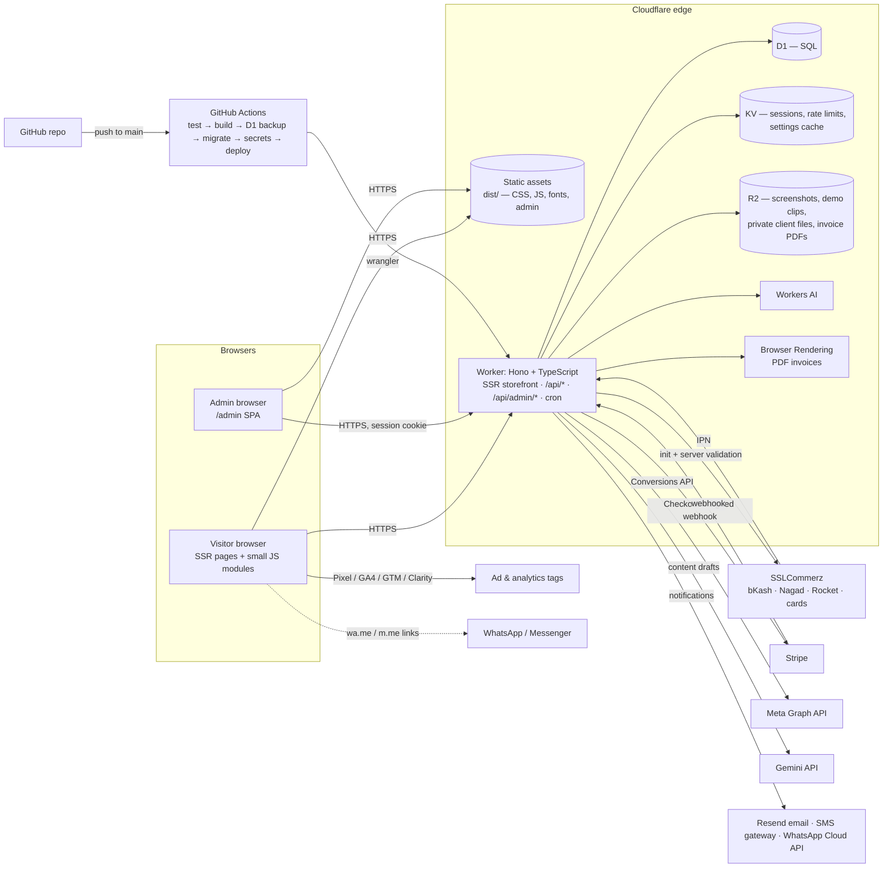

# Cwb Agency — Website & Web-Development Marketplace

**A–Z specification and implementation guide** for `shop.sayadbayezid.com`

> This document describes the system as it is **implemented in this repository**. Wherever the spec required a decision the brief left open, it is marked **⚠ ASSUMPTION (adjustable)**. Please confirm those before launch. The full list is in [§24](#24-assumptions-to-confirm).

---

## 1. Brand, Business Model & Scope

| Item | Decision |
|---|---|
| Brand name | **Cwb Agency** (owner's choice). This name and machine identifiers are the only Latin text in the UI; see [§23](#23-acceptance-checklist). |
| Tagline (default, editable) | “লাইভ ডেমো দেখুন, দাম জেনে নিন — আপনার ব্যবসার ওয়েবসাইট আমরা বানিয়ে দেব” |
| Business model | A **productized-service marketplace**. Each “product” is a website package (niche × tier), or a custom build reached through a quote. The client buys development *work*, so nothing is downloaded instantly. |
| Market | Bangladeshi small-business owners, reached mainly through daily Facebook/Instagram ad creatives |
| Language | **Bangla only** across storefront, admin, emails/SMS and errors. There is no toggle and there are no bilingual fields. |

**Logo concept.** The mark is a rounded square filled with the electric-blue → violet gradient, containing white code brackets `< / >` with a slanted stroke. It reads as “we build software” at favicon size (`public/assets/img/favicon.svg`, `logo.svg`). The wordmark is “Cwb Agency”, set in Anek Bangla (variable, Latin subset), so it shares a typeface with the Bangla headlines.

**Two conversion paths side by side.** Every package page carries both a primary **“এখনই অর্ডার করুন”** (Order Now) button and a secondary **“কাস্টম চাহিদা? কোটেশন নিন”** (custom requirement? get a quote) button. The site also has a quote page, a contact form, a “Which package fits me?” quiz, the chat hand-off and landing-page lead forms. All of these feed the **Leads** pipeline.

**Categories** are fully admin-managed (add / edit / activate / deactivate / reorder / per-category offers). The seed set is Fashion, Clothing, Gadgets & Tech, Herbal, News Portal and Blog Publisher.

## 2. Public Website — Design & Navigation

**Visual system** (`public/assets/css/site.css`):
- The dark base is `#0b0a1f` (indigo, near black). The accent is a **soft, layered mesh gradient**: three radial glows in blue `#3b82f6`, violet `#8b5cf6` and indigo `#6366f1`. It is a soft glow, not a hard rainbow.
- Headlines use **Anek Bangla** (bold, modern sans). Body text uses **Hind Siliguri**. Both are self-hosted woff2 files from npm, with no Google Fonts request.
- **Light and dark themes are adaptive through colour tokens.** The site follows the OS setting, the user can switch with a toggle, and the choice is remembered. A tiny `theme.js` runs in `<head>` so there is no theme flash.
- **One motion language.** A single `--ease`/`--dur` pair drives the hover-lift and glow on category cards, package cards, configurator add-ons, payment methods, chat options and quiz options. All motion is disabled under `prefers-reduced-motion`.

**Performance (dogfooding):**
- Pages are server-rendered by the Worker, so content arrives in the first byte.
- One CSS file is loaded. JS is split: the core module is tiny, and the configurator, checkout, portal, quiz and chat code are lazy `import()`s that load only on the page that needs them. The chat module loads on the first click.
- Images and videos lazy-load. Demo clips are muted, `playsinline` and `preload="none"`.
- No third-party UI libraries are used on the storefront.
- A PWA service worker caches static assets and serves an offline page.

**Site map**

| Path | Page |
|---|---|
| `/` | Home: rotating browser-frame showcase of demo sites (video if uploaded), category grid, how-it-works, featured packages, **real** social proof, FAQ teaser, quiz/quote CTA |
| `/category/:slug` | All packages in the category: showcase, name, short description, starting price, **live offer badge + countdown**, visible coupon chip |
| `/package/:slug` | Gallery (screenshots + demo clip), **live demo button**, features, description, **configurator** (toggles + quantity steppers, live price), package FAQ, reviews, Order Now + Get a Quote |
| `/checkout` (`/cart` → 301) | Cart lines (server-priced), coupon field, customer form, payment method, terms consent |
| `/order/:no?t=` | Payment result / manual payment instructions / “pay again” |
| `/portal/:no?t=` | **Client project portal**: pipeline timeline, requirements intake (after payment), file uploads, preview & approve / request revisions, messages, deliveries, invoice, review, referral code |
| `/account` | Order status lookup (order number + phone). The private link is re-sent; it is never displayed. |
| `/faq`, `/about`, `/contact`, `/refund-policy`, `/terms`, `/privacy` | Static pages (text editable in admin) |
| `/quote`, `/quiz` | Quote request; “Which package fits me?” quiz |
| `/lp/:slug` | **Unlimited admin-built landing pages.** No main nav, own SEO and own UTM defaults. |
| `/invoice/:no?t=` | PDF invoice (Browser Rendering), with a print-ready HTML fallback |

**Requirements intake after payment.** The checkout redirects to the gateway. On return, the order page shows **“প্রজেক্টের তথ্য জমা দিন”** (submit project details), which opens the portal form. The form collects business name and description, audience, domain status and preference, colours, reference sites, pages needed, product count, content readiness, social links, WhatsApp number and notes, plus file uploads.

## 3. Category & Package Offer System

- **Offers** (table `offers`) attach to a *category* or a *package*. Each has a percentage or flat amount, `starts_at` / `ends_at`, a `show_timer` flag and an active flag. When several offers are live, the **largest discount wins**.
- **Timers are not cosmetic.** `isOfferLive()` in `shared/pricing.ts` excludes an offer the instant `now >= ends_at`, on the server. The browser countdown reaches zero and reloads, so the page re-renders at full price. The checkout re-prices on the server in any case.
- **Coupons** (`coupons`) can be percentage or flat, sitewide or scoped to one category or package. They support start and expiry dates, a usage limit, a minimum order and an “show on card” flag. Codes are case-insensitive. Usage increments only when a payment is confirmed.
- **Configurator pricing.**

  ```
  line = base + Σ(addon.price × qty)
  line −= best live offer
  cart = Σ lines − coupon
  ```

  - All values are whole Taka.
  - **The same module (`shared/pricing.ts`) is bundled into the browser (`/assets/js/pricing.js`) and into the Worker.** The browser result is only a preview.
  - `POST /api/orders` recomputes the total from database prices.
  - If the client's `expectedTotal` differs, the order is refused with **409 `price_changed`** and the new total is shown. The visitor is never silently charged a different amount.
  - `tests/unit/client-server-parity.test.ts` proves byte-for-byte parity over 500 random configurations.

## 4. Admin Dashboard

`/admin/` is a lightweight vanilla-JS single-page app, served as static assets with a strict CSP (`script-src 'self'`). It uses the same indigo/violet theme, denser, with a dark/light toggle.

**Three-pane layout**
- **Left:** a collapsible sidebar with Dashboard, Categories, Packages, Landing Pages, Orders/Projects, Leads, Coupons, Category Offers, Banners/Popups, FAQ, Reviews, Chats, Chat Settings, AI Settings, Reports, Staff & Roles, Activity Log, System Settings and Help Center. Lead and chat counts show as badges.
- **Centre:** the dashboard home, in this order:
  1. **Health-check strip.** Each item reads “সংযুক্ত” (connected) or “এখনো সংযুক্ত নয়” (not connected yet), covering payment, bank details, pixel, CAPI, GA4, Clarity, Gemini, email, SMS, WhatsApp and the encryption key.
  2. **Guided first-run checklist.**
  3. **“আজ যেগুলোতে আপনার নজর দরকার” (Needs your attention today):** new leads with a one-tap “followed up”, chats escalated to a human, payments awaiting verification, orders stuck in one status too long with a one-tap “next step”, and pending reviews.
  4. **KPI cards:** today's orders, today's revenue, 30-day revenue, today's leads, active chats and projects awaiting delivery.
  5. A **Chart.js** sales chart (vendored, no CDN) and the recent-orders table.
- **Right:** a search box (order number or lead), a profile dropdown (theme, password change, logout), the notification feed with unread count, and staff online status (seen within 5 minutes).
- **Responsive.** Below 1200 px the right pane becomes a drawer; below 720 px the left pane becomes off-canvas. The admin is fully usable from a phone.

**CRUD interactions.**
- Forms open in slide-over panels with native and server-side validation; field errors are highlighted and shown inline in Bangla.
- Deleting asks for confirmation in a dialog.
- Every save or failure shows a toast.
- Search, filters and pagination are available on every list.
- **Restricted actions are hidden** based on the `permissions` list from `/auth/me`, and are always enforced again on the server.

| Module | Notes |
|---|---|
| Categories | Name, slug, icon, image, active, order. The “অফার” (offer) shortcut opens that category's offers. |
| Packages | Full editor:<br>• category, base price, delivery days, status (active / inactive / coming soon), featured<br>• live demo URL, screenshots (R2 upload), demo clip (mp4/webm)<br>• feature list<br>• inline **add-on** sub-table (price delta, max quantity)<br>• inline **package offers**<br>• **✨ AI auto-suggest** → draft panel → edit → **one-tap approve**, or discard |
| Landing Pages | Block builder with hero, offer + timer, features, package cards, testimonials, FAQ, CTA, lead form, text and video blocks. Blocks can be reordered or removed. Each page has its own slug, SEO fields and UTM defaults. The ready-to-paste ad URL template is shown. Pages move **Draft → Published → Retired**. |
| Orders / Projects | Pipeline chips and one-tap next-status buttons with an optional note to the client.<br>Payment verification panel (amount plus an explicit “I saw it on the statement” checkbox).<br>Encrypted requirements behind a “view” button, which is **audit-logged**.<br>Client files, preview URL, delivery links and files, internal notes, message thread, status history, invoice link and portal link. |
| Leads | Source, status (new / contacted / follow-up / won / lost), next follow-up, notes, call and WhatsApp links, and a count of automatic follow-ups sent |
| Coupons, Category Offers, Banners/Popups, FAQ | Scheduled, scoped and editable without a developer |
| Reviews | Moderation queue (approve / reject). The **verified** flag is not editable. |
| Chats / Chat Settings | Escalated transcripts. Channel toggles, WhatsApp number and prefilled message, Messenger page, AI greeting, extra knowledge, escalation text. |
| AI Settings | Per purpose (content / chat): provider, model, system prompt, tone. The **masked key** shows only its last 4 characters. **Test connection** button. |
| Reports | Date range, summary, **per source / campaign / ad-content** conversion and revenue, per landing page, per package, payment methods, lead sources, pipeline, referrals. CSV exports. |
| Staff & Roles, Activity Log, System Settings, Help Center | See §12 and §22 |

## 5. Order & Project Delivery Flow

```
pending_payment → confirmed → requirements_collected → in_development
                → client_review ⇄ revisions → delivered → completed     (+ cancelled)
```

- **Hard rule: no work before payment.**
  - `confirmed` can only be set by `confirmPayment()`. Admins cannot select it.
  - Every forward transition requires `payment_status = 'paid'`.
  - The requirements form, file uploads and messages return **403 `payment_required`** until then. This is tested in both integration and E2E tests.
- **Who moves which step:**
  - The client's first requirements submission moves `confirmed → requirements_collected`.
  - In `client_review` the client can **approve** (→ `delivered`) or **request revisions** (→ `revisions`) directly from the preview.
  - Moving to `client_review` requires a preview URL.
  - `completed` issues the client's referral coupon and enables the review form.
- **Notifications.** Every status change writes history and sends the client a Bangla notification with their private portal link. Channels are email (Resend), SMS (template URL for any Bangladeshi gateway) and WhatsApp (Cloud API template). Unconfigured channels are logged as *skipped*, never faked.
- **Invoices.** Numbers look like `INV-YYYY-000001`. They are **sequential and gapless**, assigned atomically (`UPDATE counters … RETURNING`) only by the request that wins the “mark paid” race. Abandoned unpaid orders therefore never consume invoice numbers. Order numbers (`ORD-YYMMDD-0001`) are assigned at creation. The PDF is rendered by Cloudflare Browser Rendering and cached in R2; without that binding a print-ready page (“Save as PDF”) is served.
- **Private links.** Portal and order links carry `t = HMAC(SESSION_SECRET, order number)`. Nothing is stored. Rotating the secret revokes every link at once (incident response).

## 6. Multi-Channel Chat

Clicking the chat bubble always opens a **picker** first:
- **🤖 এআই সাপোর্ট** (AI support)
- **💬 হোয়াটসঅ্যাপ** (WhatsApp, via a `wa.me` link with a prefilled message)
- **মেসেঞ্জার** (Messenger, via `m.me/<page>`)

Channels that are disabled or unconfigured are hidden.

**AI support** (`POST /api/chat/ai`):
- Uses the configured provider (default: Workers AI Llama 3.3 70B).
- The system prompt is grounded on the **live** package list, prices, live offers, sitewide and package FAQs, the delivery process and the admin's extra knowledge.
- The model must start its reply with `[ESCALATE]` when unsure or when the visitor asks for a person; provider errors also escalate.
- On escalation the conversation is flagged, admins are notified, and the visitor gets a name + phone hand-off form. That form creates a `chat` lead and fires a `Lead` event.
- Transcripts are capped and rate-limited.

## 7. AI-Assisted Content Generation

```ts
interface AIProvider { id: 'gemini' | 'workers_ai' | 'openai'; label: string; generate(i: AIGenerateInput): Promise<string> }
```

- **Adapters:** `lib/ai-providers/gemini.ts` (**default for content**), `workers-ai.ts`, `openai.ts`. Adding a provider means one new file and one registry line in `index.ts`.
- **Keys** are Wrangler secrets (`GEMINI_API_KEY`, `OPENAI_API_KEY`). The admin UI can neither read nor write them. It shows `••••••••a1b2`, and the test endpoint redacts key-like strings from error messages.
- **Draft-only flow.**
  1. `POST /api/admin/ai/suggest` writes to `packages.ai_draft`; public APIs never return that field.
  2. The admin edits the draft and taps **approve** (`/packages/:id/approve-draft`), which copies it into the live fields and audit-logs the action, or discards it.
  3. An integration test asserts the public name is unchanged until approval.

## 8. Full-Stack Architecture



## 9. Data Models

All timestamps are ISO-8601 UTC `TEXT`. All money is integer Taka. The schema lives in `worker/migrations/0001_init.sql`.

**categories**

| column | type | notes |
|---|---|---|
| id | INTEGER PK | |
| slug | TEXT UNIQUE | URL |
| name, description, icon | TEXT | |
| image_key | TEXT | R2 key |
| is_active, sort_order | INTEGER | |
| created_at, updated_at | TEXT | |

**packages**

| column | type | notes |
|---|---|---|
| id | INTEGER PK | |
| category_id | FK → categories | RESTRICT |
| slug | TEXT UNIQUE | |
| name, tier, short_description, description | TEXT | |
| base_price | INTEGER ≥ 0 | Taka |
| delivery_days | INTEGER | |
| demo_url | TEXT | live demo |
| demo_video_key | TEXT | R2 |
| images, features | TEXT (JSON array) | |
| status | `active`/`inactive`/`coming_soon` | |
| is_featured, sort_order | INTEGER | |
| ai_draft | TEXT (JSON) | pending human approval, never public |

**package_addons**

| column | type | notes |
|---|---|---|
| id | INTEGER PK | |
| package_id | FK CASCADE | |
| name, description | TEXT | |
| price_delta | INTEGER ≥ 0 | |
| max_quantity | INTEGER ≥ 1 | 1 = toggle |
| is_active, sort_order | INTEGER | |

**offers** (needed for §3)

| column | type | notes |
|---|---|---|
| id | INTEGER PK | |
| scope, scope_id | `category`/`package`, id | |
| title | TEXT | |
| discount_type, discount_value | `percent`/`flat`, INTEGER | |
| starts_at, ends_at | TEXT | enforced server-side |
| show_timer, is_active | INTEGER | |

**landing_pages**

| column | type | notes |
|---|---|---|
| id | INTEGER PK | |
| slug | TEXT UNIQUE | `/lp/:slug` |
| title, seo_title, seo_description | TEXT | |
| status | `draft`/`published`/`retired` | |
| blocks | TEXT (JSON) | page-builder blocks |
| utm_source, utm_medium, utm_campaign | TEXT | defaults for ad links |
| published_at, retired_at | TEXT | |

**orders**

| column | type | notes |
|---|---|---|
| id | INTEGER PK | |
| order_number | TEXT UNIQUE | `ORD-…` |
| invoice_number | TEXT UNIQUE NULL | `INV-…` on payment |
| customer_name, customer_phone (8801…), customer_email, business_name | TEXT | |
| payment_method | TEXT | bkash/nagad/rocket/card/bank_transfer/stripe |
| payment_status | `unpaid`/`pending_verification`/`paid`/`failed`/`refunded` | |
| project_status | pipeline (§5) | |
| subtotal, offer_discount, coupon_discount, total, paid_amount | INTEGER | |
| coupon_id, coupon_code | | |
| gateway, gateway_session, gateway_tran_id, gateway_val_id, manual_trx_id, manual_sender, paid_at | TEXT | |
| initiate_event_id, purchase_event_id, purchase_sent_at | TEXT | pixel/CAPI dedup + idempotency |
| utm_source…utm_term, fbclid, fbp, fbc, landing_page_id, referral_code, source_url, client_ip, user_agent | | attribution |
| internal_notes, preview_url, delivery_links (JSON), assigned_admin_id | | delivery |
| status_changed_at, created_at, updated_at | TEXT | stuck detection |

**order_items**

| column | type | notes |
|---|---|---|
| id | INTEGER PK | |
| order_id | FK CASCADE | |
| package_id, package_name | snapshot | |
| base_price | INTEGER | |
| addons | TEXT (JSON PricedAddon[]) | |
| subtotal, offer_id, offer_discount, total | INTEGER | |

**project_requirements**

| column | type | notes |
|---|---|---|
| id | INTEGER PK | |
| order_id | FK UNIQUE | |
| encrypted_payload, iv | TEXT | **AES-256-GCM**, key = `DATA_ENCRYPTION_KEY` |
| key_version | INTEGER | rotation |
| submitted_at, updated_at | TEXT | |

**leads**

| column | type | notes |
|---|---|---|
| id | INTEGER PK | |
| source | `quote`/`chat`/`quiz`/`landing`/`contact` | |
| name, phone, email, business_name, message | TEXT | |
| package_id, quiz_result | | |
| status | `new`/`contacted`/`follow_up`/`won`/`lost` | |
| notes, next_follow_up_at, last_contacted_at, auto_followups_sent, assigned_admin_id | | follow-up |
| lead_event_id | TEXT | shared pixel/CAPI id |
| utm_*, fbclid, landing_page_id, source_url | | attribution |

**coupons**

| column | type | notes |
|---|---|---|
| id | INTEGER PK | |
| code | TEXT UNIQUE (upper) | |
| description | TEXT | |
| discount_type, discount_value | | |
| scope, scope_id | `sitewide`/`category`/`package` | |
| starts_at, expires_at | TEXT | |
| usage_limit, used_count, min_subtotal | INTEGER | |
| show_on_card, is_active | INTEGER | |
| referrer_order_id | INTEGER | referral program |

**banners**

| column | type | notes |
|---|---|---|
| id | INTEGER PK | |
| kind | `bar`/`popup` | |
| title, body, cta_label, cta_url, image_key | TEXT | |
| target | `all`/`home`/`category`/`package`/`landing` | |
| starts_at, ends_at | TEXT | scheduled |
| is_active, sort_order | INTEGER | |

**faqs**

| column | type | notes |
|---|---|---|
| id | INTEGER PK | |
| question, answer | TEXT | |
| scope | `sitewide`/`package` | |
| package_id | INTEGER | |
| sort_order, is_active | INTEGER | |

**reviews**

| column | type | notes |
|---|---|---|
| id | INTEGER PK | |
| order_id, package_id | INTEGER | |
| author_name, author_business, body | TEXT | |
| rating | 1–5 | |
| status | `pending`/`approved`/`rejected` | |
| is_verified | INTEGER | 1 **only** when submitted from a real order's portal |

**admins**

| column | type | notes |
|---|---|---|
| id | INTEGER PK | |
| email | TEXT UNIQUE | |
| name | TEXT | |
| password_hash | TEXT | PBKDF2-SHA256 100k, salted |
| role | `super_admin`/`sales_support`/`project_manager`/`viewer` | |
| is_active, last_login_at, last_seen_at | | |

**ai_provider_configs** (masked keys only)

| column | type | notes |
|---|---|---|
| id | INTEGER PK | |
| purpose | `content`/`chat` UNIQUE | |
| provider | `gemini`/`workers_ai`/`openai` | |
| model | TEXT | |
| secret_name | TEXT | *name* of the Wrangler secret |
| key_hint | TEXT | `••••••••a1b2`, never the key |
| system_prompt, tone | TEXT | |
| last_test_at, last_test_ok | | |

**chat_settings** (single row)

| column | type |
|---|---|
| ai_enabled, whatsapp_enabled, messenger_enabled | INTEGER |
| whatsapp_number, whatsapp_message, messenger_page | TEXT |
| greeting, knowledge, escalation_message | TEXT |

**activity_log**

| column | type | notes |
|---|---|---|
| id | INTEGER PK | |
| admin_id | INTEGER | |
| action, entity, entity_id | TEXT | |
| details | TEXT (JSON) | secrets/passwords redacted |
| ip, created_at | TEXT | |

Supporting tables: `settings` (key/JSON value), `counters` (invoice/order sequences), `order_status_history`, `order_messages`, `order_files`, `chat_conversations`, `admin_notifications`, `notification_log`, `payment_events` (webhook idempotency, `UNIQUE(gateway, external_id)`).

**Worked example — the Order model**

```ts
import type { ProjectStatus, PaymentStatus, PaymentMethod } from './shared/status';

export interface OrderAddon { addonId: number; name: string; quantity: number; unitPrice: number; amount: number }

export interface OrderItem {
  packageId: number;
  packageName: string;          // snapshot at purchase time
  basePrice: number;            // Taka
  addons: OrderAddon[];         // the configured add-ons
  subtotal: number;
  offerId: number | null;
  offerDiscount: number;
  total: number;
}

export interface Order {
  id: number;
  orderNumber: string;                 // "ORD-261031-0001"
  invoiceNumber: string | null;        // "INV-2026-000001" — assigned sequentially when payment is confirmed
  customer: { name: string; phone: string /* 8801XXXXXXXXX */; email: string; businessName: string };
  items: OrderItem[];                  // configured package(s) + add-ons
  subtotal: number;
  offerDiscount: number;
  coupon: { id: number; code: string; discount: number } | null;
  total: number;                       // server-computed; never the browser's number
  currency: 'BDT';
  paymentMethod: PaymentMethod;
  paymentStatus: PaymentStatus;        // 'unpaid' | 'pending_verification' | 'paid' | 'failed' | 'refunded'
  paidAmount: number | null;
  paidAt: string | null;
  projectStatus: ProjectStatus;        // 'pending_payment' | 'confirmed' | 'requirements_collected' | 'in_development'
                                       // | 'client_review' | 'revisions' | 'delivered' | 'completed' | 'cancelled'
  requirementsRef: { orderId: number; submittedAt: string } | null; // → project_requirements (encrypted)
  previewUrl: string;
  deliveryLinks: { label: string; url: string }[];
  tracking: {
    initiateEventId: string;           // shared by pixel + CAPI
    purchaseEventId: string;           // shared by pixel + CAPI
    purchaseSentAt: string | null;     // idempotency; null in sandbox forever
    utm: { source: string; medium: string; campaign: string; content: string; term: string };
    fbclid: string; fbp: string; fbc: string;
    landingPageId: number | null;
    referralCode: string;
  };
  createdAt: string;
  statusChangedAt: string;
}
```

## 10. Payments

| Method | Route | Confirmation |
|---|---|---|
| bKash, Nagad, Rocket, Visa/Mastercard | **SSLCommerz** hosted checkout (`multi_card_name` pre-selects the channel) | Server-to-server **validation API** on both the IPN and the browser return. Checks `tran_id`, BDT currency and amount ≥ total. Risk-flagged payments are held for a human. |
| Bank transfer | Manual: the client submits a reference | Staff verify against the statement (explicit checkbox + amount), logged in the audit log |
| bKash / Nagad / Rocket send-money (only when no gateway is configured) | Manual | Same as bank transfer |
| International card | **Stripe Checkout** (USD at the admin-set rate) | Signed webhook (`Stripe-Signature` v1, 5-minute tolerance) + session-id match |

- Webhooks are idempotent (`payment_events`). `confirmPayment()` is idempotent and race-safe.
- **Crypto is deliberately not offered.** Bangladesh Bank has repeatedly said cryptocurrency transactions are not authorized and may fall under the Money Laundering Prevention Act. Get specific legal advice before ever revisiting this.
- Payment is captured before `confirmed`, and requirements intake unlocks only after (§5).
- `PAYMENT_MODE=sandbox` uses the SSLCommerz sandbox and **disables Purchase events entirely**.

## 11. Marketing, Tracking & Analytics

**Defaults:** Pixel `1469319801771203`, GA4 `G-HY9255GJYE`, GTM `GTM-P5BR4D3F`. All three are editable in System Settings. The CAPI token comes from the existing GitHub secret **`META_CONVERSATION_API`**, synced to the Worker secret `META_CAPI_TOKEN` by the deploy workflow.

| Event | Browser | Server (CAPI) | Shared `event_id` |
|---|---|---|---|
| PageView | on load | beacon → Worker | random `pv_…` |
| ViewContent | package page | beacon → Worker | `vc_…` rendered by the server |
| Lead | after `/api/leads` (or chat hand-off) returns | when the lead row is inserted | `ld_…` returned by the server |
| InitiateCheckout | after `/api/orders` returns | when the order row is inserted | `ic_…` stored on the order |
| Purchase | order page, **only if the server rendered a purchase block** | `sendPurchaseIfPaid()` | `pu_…` stored on the order |

**The never-fake-events rules, enforced in code:**
1. **Purchase has exactly one server path,** `sendPurchaseIfPaid()`. It requires `payment_status='paid'` (set only by gateway validation or human statement verification) **and** `PAYMENT_MODE='live'`. It is idempotent through an atomic claim on `purchase_sent_at`.
2. `sendMetaEvent()` refuses `Purchase`. The `/api/track` beacon accepts **only** PageView and ViewContent (tested). `SBTrack.fire()` in the browser refuses Purchase.
3. Outside `APP_ENV=production` the page config contains **no** pixel, GA4, GTM or Clarity IDs, and CAPI is disabled, so staging and dev traffic cannot reach the production pixel.
4. User data is hashed (SHA-256) after normalisation, and phones are converted to `8801…`. `fbp` and `fbc` (from the `fbclid` click id) are passed for match quality.

**Other rules:**
- **Consent.** Tracking is not gated. The footer carries a one-line notice linking to the privacy page, which explains the pixel, GA4, Clarity and hashed matching.
- **Attribution.** UTM tags, `fbclid`, `ref` and landing-page id are captured first-touch and last-touch (28-day window) and stored on **every order and lead**. Reports group by source / campaign / **utm_content** (one row per ad creative) and by landing page.
- **Landing pages.** Each page records its own `landing_page_id`. The admin shows the ad URL template: `…/lp/<slug>?utm_source=facebook&utm_campaign=<x>&utm_content={{ad.name}}`.
- **Double counting.** If GA4 is also configured *inside* GTM, clear one of the two IDs to avoid duplicate sessions.

## 12. Security & Compliance (NIST CSF 2.0)

| Function | Implementation |
|---|---|
| **Govern** | RBAC matrix in `worker/src/lib/rbac.ts`. Role definitions are shown in the admin. Secrets policy: Wrangler secrets only, `.dev.vars` git-ignored, `.dev.vars.example` holds placeholders. |
| **Identify** | Data inventory = §9. Sensitive data: client requirements and files, contact details, payment references. |
| **Protect** | • PBKDF2-SHA256 (100k, salted) password hashing<br>• Sessions: hashed tokens in KV, `__Host-` cookie, HttpOnly, Secure, SameSite=Strict, 12 h TTL, revoked on role or password change<br>• CSRF: Origin check + required `X-Requested-With` header<br>• HTTPS redirect + HSTS preload, CSP (strict for admin), `X-Content-Type-Options`, `frame-ancestors 'none'`<br>• Rate limits on login (per IP + per user), setup, checkout, leads, chat, uploads, lookups and tracking<br>• **AES-256-GCM encryption of requirements**; decrypting them requires `requirements.read` and is audit-logged<br>• Private R2 prefix for client files, served only through token- or role-checked routes, with content-type allow-list and size limits<br>• Escaped SSR templates, CSV formula-injection guard, honeypot on lead forms |
| **Detect** | `activity_log` (logins, failed logins, every mutation, exports, requirement views, payment verifications). Workers observability logs. Admin notifications for payments, risk-flagged gateway payments, escalations and stuck projects. |
| **Respond** | See `docs/RUNBOOK.md`: rotate secrets (`SESSION_SECRET` also revokes all portal links), revoke sessions, disable staff, put SSLCommerz into maintenance, notify affected clients. |
| **Recover** | Every deploy takes a `wrangler d1 export` backup first (kept as a 30-day artifact). D1 Time Travel restore. Restore drill in the runbook. |

## 13. Premium Design — What “Perfect” Means Here

- **Dogfooding.** Server-rendered HTML, self-hosted subset fonts, lazy modules, no UI framework and edge caching. The site's own speed is the first proof point.
- **Show, don't tell.** Every package card is a browser frame. The hero rotates real demo sites with **muted demo clips**, and “লাইভ ডেমো ↗” (live demo) opens the deployed site, for example Lk's Attire for Clothing. Until a screenshot is uploaded, a branded placeholder appears. **No fake screenshots** are ever shown.
- **Pricing transparency.** “From” prices appear on cards. The live configurator shows every add-on line, and checkout prices are verified by the server.
- **One motion language** (§2).

## 14. Testing Strategy

| Layer | Command | What it covers |
|---|---|---|
| Unit (Node) | `npm test` (project `unit`) | Pricing rules, offer expiry, coupons, **client ↔ server parity (500 random configs)**, CAPI hashing and `event_id`, phone normalisation, HTML escaping, pipeline transitions, password hashing, AES-GCM, Stripe signatures |
| Integration (real Workers runtime via `@cloudflare/vitest-plugin`, D1 migrations applied) | `npm test` (project `integration`) | **JSON fixtures** `tests/fixtures/package-list.json`, `create-order.json`, `admin-login.json`; server quote = client total; tampered total rejected (409); expired offer; **payment-before-requirements**; sequential invoices; **no Purchase in sandbox**; encrypted storage; bad token; bad login; CSRF; viewer RBAC; AI draft gate; beacon refuses Purchase/Lead/InitiateCheckout; lead attribution; landing publish/retire |
| E2E (Playwright, desktop + mobile against `wrangler dev`) | `npm run test:e2e` | **configure → checkout → pay (bank ref + admin verification) → requirements intake**; chat picker shown first; no horizontal overflow on mobile |
| Type check | `npm run typecheck` | Worker, shared code and tests. Required before deploy (CI). |

## 15. Dashboard Development Plan

- **No framework.** The storefront is server-rendered with small vanilla-JS ES modules. The admin is a vanilla-JS SPA (`admin/assets/js/core.js` primitives, `views.js` special screens, `main.js` resource configs and router).
- **Generic CRUD.** One `listView` + `openForm` drives every list (declarative columns, filters, fields).
- **Server side.** A single `registerCrud` factory provides validation, unique/FK error mapping, audit logging and permissions.
- **Charts.** Chart.js 4 is vendored into `dist/admin/assets/vendor`.
- **Responsive.** Tablet and phone layouts as described in §4.

## 16. File & Folder Structure

```
shop.sayadbayezid.com/
├── worker/
│   ├── src/
│   │   ├── index.ts                 Hono app, security headers, media, sitemap, cron entry
│   │   ├── env.ts                   bindings & secrets types
│   │   ├── routes/
│   │   │   ├── pages.ts             SSR storefront, landing pages, order/portal shells
│   │   │   ├── public-api.ts        categories, packages, leads, tracking beacon, chat
│   │   │   ├── orders.ts            pricing quote, checkout, payments (SSLCommerz/Stripe/manual), invoice, lookup
│   │   │   ├── portal.ts            client portal: requirements, uploads, review step, reviews
│   │   │   └── admin/
│   │   │       ├── index.ts         auth, dashboard, orders, leads, chats, AI, settings, reports, uploads
│   │   │       ├── resources.ts     categories, packages, add-ons, offers, coupons, banners, FAQs, reviews, landing pages, staff
│   │   │       └── crud.ts          generic validated CRUD + CSV
│   │   ├── lib/
│   │   │   ├── payment/             sslcommerz.ts, stripe.ts
│   │   │   ├── ai-providers/        types.ts, gemini.ts, workers-ai.ts, openai.ts, index.ts
│   │   │   ├── orders.ts            pipeline, confirmPayment, invoice numbers, referrals
│   │   │   ├── meta-capi.ts         CAPI + Purchase guard
│   │   │   ├── contact-links.ts     wa.me / m.me
│   │   │   ├── notify.ts            email / SMS / WhatsApp
│   │   │   ├── auth.ts, rbac.ts, crypto.ts, ratelimit.ts, audit.ts, portal-token.ts
│   │   │   ├── catalog.ts, settings.ts, attribution.ts, cron.ts, html.ts, http.ts, util.ts
│   │   └── views/                   layout.ts, components.ts, pages.ts (Bangla templates + invoice)
│   ├── migrations/                  0001_init.sql, 0002_seed.sql
│   ├── wrangler.toml                production + staging
│   └── wrangler.local.toml          local dev & tests
├── shared/                          pricing.ts (client + server), status.ts (pipeline, labels, roles)
├── public/                          assets/css, assets/js, assets/img, sw.js, manifest.webmanifest
├── admin/                           index.html, assets/admin.css, assets/js/{core,views,main}.js
├── scripts/build.mjs                assets → dist/ (fonts, Chart.js, pricing bundle, _headers)
├── tests/                           unit/, integration/, e2e/, fixtures/
├── .github/workflows/               ci.yml, deploy.yml
└── docs/                            SPEC.md, RUNBOOK.md, reference/ (original pixel/GA notes)
```

## 17. Development Environment & Deployment

**Prerequisites:** Node.js **22+** and a Cloudflare account. `wrangler` is a dev dependency.

```bash
npm ci
cp .dev.vars.example worker/.dev.vars     # fill in local values
npm run dev                               # build + local D1 migrations + wrangler dev on :8787
npm test && npm run test:e2e
```

**One-time Cloudflare setup:**

```bash
npx wrangler login
npx wrangler d1 create shop-sayadbayezid-db            # → paste database_id into worker/wrangler.toml
npx wrangler kv namespace create KV                     # → paste id into worker/wrangler.toml
npx wrangler r2 bucket create shop-sayadbayezid-media
node -e "console.log(require('crypto').randomBytes(32).toString('base64'))"   # DATA_ENCRYPTION_KEY
npx wrangler secret put SESSION_SECRET        --config worker/wrangler.toml
npx wrangler secret put DATA_ENCRYPTION_KEY   --config worker/wrangler.toml
npx wrangler secret put ADMIN_SETUP_TOKEN     --config worker/wrangler.toml
npx wrangler secret put META_CAPI_TOKEN       --config worker/wrangler.toml
npx wrangler secret put SSLCOMMERZ_STORE_ID   --config worker/wrangler.toml
npx wrangler secret put SSLCOMMERZ_STORE_PASSWORD --config worker/wrangler.toml
npx wrangler secret put GEMINI_API_KEY        --config worker/wrangler.toml
npm run db:migrate:remote && npm run deploy
```

Then open `/admin/`, enter `ADMIN_SETUP_TOKEN` and create the first Super Admin. Other optional secrets are listed in `.dev.vars.example`.

**Going live with payments.** Put live SSLCommerz credentials in place, then set `PAYMENT_MODE = "live"` in `wrangler.toml`. Until then, no Purchase event is ever sent.

**GitHub.**
- **Branches:** feature branches lead to PRs (`ci.yml`: build, typecheck, unit/integration, E2E). Merging to `main` runs `deploy.yml`: tests → D1 backup → migrations → secret sync → `wrangler deploy`.
- **Repository secrets:** `CLOUDFLARE_API_TOKEN`, `CLOUDFLARE_ACCOUNT_ID`, plus any app secrets. The existing `META_CONVERSATION_API` is mapped to `META_CAPI_TOKEN`.
- **Unconfigured deploys** are skipped with a warning until the `REPLACE_ME` ids are filled in.

**Custom domain.** `routes = [{ pattern = "shop.sayadbayezid.com", custom_domain = true }]`. Cloudflare creates the DNS record and certificate on deploy, provided `sayadbayezid.com` is a zone on the account. The old `CNAME` file only matters for GitHub Pages; turn Pages off for this repo to avoid a conflicting record.

**Staging:** `wrangler deploy --env staging` uses sandbox payments with no tracking IDs.

## 18. Initial Categories & Packages (seed)

⚠ **ASSUMPTION (adjustable):** every price below is a placeholder to confirm.

| Category | Basic | Premium |
|---|---|---|
| Fashion, Clothing, Gadgets & Tech, Herbal | ৳12,000 (7 days) | ৳25,000 (14 days) |
| News Portal | ৳15,000 (10 days) | ৳30,000 (21 days) |
| Blog Publisher | ৳8,000 (5 days) | ৳15,000 (10 days) |

| Add-on | Price | Max qty |
|---|---|---|
| Extra page | ৳1,000 each | 10 |
| AI chatbot | ৳5,000 | 1 |
| Custom domain setup | ৳1,500 | 1 |
| Extra landing page | ৳3,000 each | 5 |
| Meta Pixel + Conversions API setup | ৳3,500 | 1 |
| Online payment gateway (e-commerce only) | ৳4,000 | 1 |

Live demo URLs (e.g. Lk's Attire) are **left empty** because the real URLs were not provided. Add them in Admin › Packages.

## 19. Phased Roadmap (delivery status)

| Phase | Scope | Status |
|---|---|---|
| 1 — MVP | Browsing, configurator, checkout (SSLCommerz bKash/Nagad/card + bank), admin CRUD, pipeline | ✅ implemented |
| 2 | Landing-page builder, coupons/timers, multi-channel chat, AI descriptions, Pixel + CAPI | ✅ implemented |
| 3 | Client review/approval, referral program, automated notifications, PWA | ✅ implemented (notifications need provider secrets) |
| Next | Direct bKash tokenized-checkout adapter, OTP login for clients, image resizing pipeline, refunds through gateway API | proposed |

## 20. Development & Delivery Conventions

Complete files are committed. `npm run typecheck` and all tests pass before any deploy (enforced in CI). Feature branches are developed from a clean checkout. No real keys exist in the repo: the pixel, GA4 and GTM IDs are public identifiers, and every token is a secret.

## 21. Additional Premium Features

| Feature | Where |
|---|---|
| Client project portal (status, feedback, approval, downloads, invoice) | `/portal/:no` |
| Referral program | A `REF…` coupon (default 5%) is issued on completion; usage appears under Reports › Referrals |
| “Which package fits me?” quiz | `/quiz`: recommends a package and offers a call-back lead |
| Automated lead follow-up | Hourly cron sends up to *N* polite follow-ups after *X* hours (configurable) and marks the lead `follow_up` |
| Stale-order cleanup | Unpaid orders older than 14 days are cancelled; no invoice number was used |
| **Honesty guardrail** | No “X people viewing” or “X sold today”. Homepage stats come from real paid orders, completed projects and approved reviews, and are hidden when zero. The “verified” badge is tied to a real order. |

## 22. Owner-Friendly Operations

- **Guided first-run.** Setup token, then the checklist: first category, a package with a demo link, a payment method, then WhatsApp/Messenger.
- **Health Check strip** in plain Bangla.
- **“Needs your attention today”** appears above the charts.
- **One-tap actions:** approve an AI draft, move to the next status, mark a lead followed up, verify a payment, approve a review.
- **CSV export** for orders, leads and reviews (UTF-8 BOM so Bangla opens in Excel).
- **Help Center** inside the admin.

## 23. Acceptance Checklist

- [x] **Bangla-only UI.**
  - Every label, message, email/SMS body and error is in Bangla, with Bangla digits for prices and dates.
  - *Deliberate exceptions:* the brand name **Cwb Agency** (owner's choice); machine identifiers clients may need to type or quote (order numbers `ORD-…`, invoice numbers `INV-…`, coupon codes, URLs, email addresses); and the slug field in admin.
- [x] Configurator recalculates live and is **re-verified on the server** (parity test + 409 on mismatch)
- [x] Offer timers really stop the discount (server-side `ends_at`, tested)
- [x] Landing pages are created, published and retired from the admin (tested)
- [x] Chat bubble shows the AI / WhatsApp / Messenger picker first (E2E)
- [x] AI output is a draft until approved (tested)
- [x] Pixel and CAPI share `event_id`; Purchase only on a real confirmed payment and never in sandbox (tested)
- [x] Unique, sequential, gapless invoice numbers + downloadable invoice
- [x] Pipeline visible to the client; every change sends a real notification (or is logged as skipped if the channel is unconfigured)
- [x] No fabricated social proof
- [x] No secrets committed

## 24. Assumptions to Confirm

1. **Prices, tiers, delivery days and add-ons** (§18) are placeholders.
2. **Brand / domain:** “Cwb Agency” on `shop.sayadbayezid.com`. Tagline, contact phone, email and address must be filled in System Settings.
3. **Live demo URLs and screenshots** need to be added per package.
4. **Payment gateway:** SSLCommerz is assumed as the single BD gateway, since it covers bKash, Nagad, Rocket and cards. A direct bKash merchant API can be added as another adapter if you have that account. Stripe is off until enabled.
5. **Refund policy, terms and privacy texts** are drafts; get legal review.
6. **Notification providers:** Resend (email), any HTTP SMS gateway (template URL) and the WhatsApp Cloud API with an approved Bangla template named in `WHATSAPP_TEMPLATE`.
7. **Chat AI** defaults to Workers AI (no key needed); Gemini is the content default. Either can be switched in the admin.
8. **GTM + GA4** are both enabled with the IDs found in this repo; remove one if GTM already contains GA4.
9. **Browser Rendering** is assumed to be available for PDF invoices. Otherwise remove the `[browser]` block; the print-to-PDF fallback remains.
10. **Referral discount** is 5%. **Stuck threshold** is 3 days. **Lead follow-up** is after 24 h, at most 2 messages.
